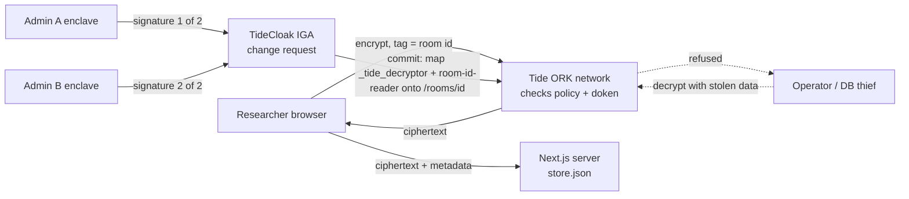

## Project overview

_**Treaty Room** is a sealed research room no one owns: rival universities, drug companies and hospitals deposit unpublished and failed results, and it opens to all of them at once only when their admins co-sign the treaty._

Built with [TideCloak](https://tide.org/tidecloak?utm_source=github&utm_medium=readme&utm_campaign=unlocked).

### 1. Vision & originality

<!-- What new product, service, experience or way of working are you proposing? What makes your idea distinctive? -->

A neutral data room with no host. Deposits are encrypted in the browser and stay sealed, even to depositors, until 2 of 3 institutions sign; then every member reads at once. Nobody reads first, so nobody has to trust first.

### 2. Trust constraint insight

<!-- What is difficult, risky or impossible today because trust, privacy or security gets in the way? Explain what becomes possible when that constraint is removed. -->

Failed and unpublished results stay in drawers: pooling them means trusting a host that could read or leak them, or a partner publishing first. Data trusts only move that trust. Remove it and competitors pool evidence before publication.

### 3. Value & impact

<!-- Who would benefit, and how would their lives or work improve? Give a concrete example of why this matters. -->

Northbridge University, Helix Therapeutics and St Aurelia Hospital pool Alzheimer's blood-test results, dead ends included, so nobody funds a cohort another lab saw fail. In Malaysia, Sunway Institute, Helix and KL General Hospital pool dengue vaccine safety signals, protecting volunteers sooner.

### 4. Why TideCloak matters

<!-- How does your application use TideCloak, and how does that integration help enable your idea? Connect the technology to the possibility you are demonstrating. -->

- Tide's ORKs threshold-sign logins; we hold no passwords and can't mint tokens.
- Each room has two `RelationshipAttestation:1` policies: its group may encrypt; only its own reader role may decrypt. Tide's nodes check every operation; plaintext never reaches us.
- The seal: the reader role reaches the room only via a change request that a quorum signs in their own Tide enclaves. We can't grant it.

### 5. Prototype & storytelling

<!-- What does your prototype demonstrate today? Describe the key interaction judges should look for. -->

The video (walkthrough mode, simulating Tide's network while its nodes were down): three institutions deposit; decryption is refused. A rogue steward's early unseal stalls at 1 of 2 signatures; a second admin co-signs and the room opens for all. The Operator view shows a thief's haul, undecryptable.

## Demo video

[demo/video.mp4](demo/video.mp4) (1 min 40 s). Team **Sunway PowerRanger**, judged in Malaysia.

The video was recorded from branch `walkthrough-demo`, not against the live Tide network. See [Demo recording](#demo-recording) for why.

## How it works

- **Identity.** Users sign in with Tide. Tokens (and the doken that carries realm roles and groups) are threshold-signed by Tide's ORK network, so the app server can verify them but cannot forge them.
- **Rooms.** Each room is a TideCloak group, `/rooms/<id>` (`alz-biomarkers`, `dengue-vax`). The group carries `_tide_encryptor`, so members can deposit.
- **Room policies.** A realm admin signs two policies per room, once, in their Tide enclave (**1. Sign deposit policy**, **2. Sign reading policy**). Both use Tide's built-in `RelationshipAttestation:1` contract with the room id as the only tag. Deposit policy: subject = the group `/rooms/<id>`, role `_tide_encryptor`. Reading policy: subject = the realm role `room-<id>-reader`, role `_tide_decryptor`. Tide's decentralised nodes check the user's doken against the policy on every `doEncrypt`/`doDecrypt`.
- **The seal.** At first nobody holds `room-<id>-reader`, depositors included, so deposits can be written but not read. The unseal is **one** IGA change request that maps both `_tide_decryptor` and `room-<id>-reader` onto the room group (Governance page, **Propose unseal: &lt;room&gt;**). Because `_tide_decryptor` is realm-wide but the reader role is per room, opening one room opens no other. Under Quorum-Enforced Governance (Tide mode) approvals are enclave signatures from each admin's own browser, and the threshold is `max(1, floor(0.7 × admins))`, which is 2 of 3. Admins can also review and sign in the **Sign in Tide console** link.
- **Joining.** **Request to join** files a request; an admin turns it into a change request with **Propose admission**, and the quorum must sign it like any other.
- **Members read.** After the change commits, members click **Refresh access** (signs out and in for a fresh token), then **Open** or **Open all**.
- **Red team.** The server-side `authorize` call is refused in multi-admin Tide mode. With `DEMO_RED_TEAM=1`, realm admins see **Force as operator** on the Governance page, which tries it with the master-admin password and shows TideCloak's answer.
- **Host view.** The database is one JSON file (`app/data/store.json`): ciphertext, signed policies and metadata. The **Operator view** shows exactly that, and **Try to decrypt with the stolen data** shows the Tide network's refusal.

Key files: `app/src/lib/rooms.ts` (rooms and the per-room reader role), `app/src/lib/tide/relationship.ts` (policy, encrypt, decrypt), `app/src/lib/kcAdmin.ts` (change-request reads and the operator red-team call), `app/src/lib/store.ts` (the ciphertext store), `app/scripts/realm.json.template` (room groups and roles), `app/scripts/init-tidecloak.sh` (realm bootstrap).

Interface: Geist and Geist Mono, zinc with an emerald accent, light and dark themes, Phosphor icons.

## Demo recording

On 22 October Tide's public ORK nodes were down (ork2, ork3 and ork7 returned HTTP 503), so no Tide account could be created and the live flow stopped before any policy could be signed. To still show the flows, the video was recorded from branch `walkthrough-demo`, which simulates the Tide calls (sign-in, policy checks, encryption, IGA signing). A banner on every screen of the video says so.

`main` has no simulation: signing in requires a real Tide account. To reproduce the recording, run `git checkout walkthrough-demo` and follow the README on that branch.

## Live TideCloak evidence

The video shows walkthrough mode, but the TideCloak side ran for real on the day. [docs/evidence/live-tidecloak.md](docs/evidence/live-tidecloak.md) has the read-back realm state:
- licensed realm `consortium` with IGA in Tide mode (`iga.attestor=tide`)
- the room seal model: groups carrying only `_tide_encryptor`, plus per-room reader roles
- a governed write answered with HTTP 202 and a change request
- 266 approved change requests and the exported Tide adapter config (threshold 14 of 20)

It also has the timestamped Tide outage errors (ork2 503s, licence `FinalizeWallet` 500) that blocked account creation.

## Setup

Using the app: [docs/USER_GUIDE.md](docs/USER_GUIDE.md) (every screen and button, Tide sign-in included).

<!-- How to install and run the prototype. -->

Full copy-paste steps and troubleshooting: [RUN_INSTRUCTIONS.md](RUN_INSTRUCTIONS.md). The app needs a real Tide login; the simulated build used for the video is on branch `walkthrough-demo` (see [Demo recording](#demo-recording)).

TideCloak must run on **Linux with Docker**: Tide's native library for Windows is a stub. We ran the official `tideorg/tidecloak-dev` image in a GitHub Codespace and forwarded port 8080 to `localhost`.

1. Copy `app/.env.example` to `app/.env` (it already sets `DEMO_RED_TEAM=1` for the Operator view) and set `KC_BOOTSTRAP_ADMIN_PASSWORD`, `TIDE_LICENSE_EMAIL` (an address you control) and `TIDE_TERMS_ACCEPTED=yes`. Set the last one only after reading [tide.org/legal](https://tide.org/legal).
2. On the Docker host, run `bash scripts/codespace-tidecloak.sh`. It starts `tideorg/tidecloak-dev` on port 8080 and runs `app/scripts/init-tidecloak.sh`, which creates realm `consortium` with the room groups and reader roles, licenses it, enables IGA and prints an invite link. Open the link to enrol the first admin in the Tide enclave.
3. If TideCloak runs in a Codespace, forward the ports before opening that invite link: `gh codespace ports forward 8080:8080 3000:3000`.
4. `cd app && npm install && npm run dev`, then open <http://localhost:3000>.
5. Enrol three admins (one per institution) for a real 2-of-3 quorum. An admin signs each room's policies once (**1. Sign deposit policy**, **2. Sign reading policy**).

Our venue network intercepted TLS, so `registry.npmjs.org` failed; `npm install --registry=https://registry.yarnpkg.com` worked.

## Limitations

- **Live login not verified end to end**, because Tide account creation failed on 22 Oct (public nodes partly down). The live setup was verified up to account enrolment; the flows after it were recorded on branch `walkthrough-demo`.
- **Institution is self-asserted.** The display name and institution in a user's profile are typed by the user, not attested. Group membership and roles, which decide access, come from the signed token.
- **Metadata is visible to the host.** The store holds each post's author name and institution, room, type (finding, dataset or question), time and ciphertext size, plus profiles, join requests and an audit log; never the content.
- **Whoever serves the JavaScript is trusted.** A malicious host could ship code that exfiltrates plaintext after it is decrypted in the browser.
- **Revocation is forward-only.** Removing a member stops future decryptions; anything they already read stays read.
- **Admitted members can copy.** Once the room unseals, a member can export what they see.
- **The host can delete or withhold ciphertext.** It cannot read or forge it, but it can deny service.
- **Two institutions can unseal over the third.** That is the agreed treaty rule (2 of 3), not a bypass.
- **Demo only.** All data is synthetic, and TideCloak runs from the `tideorg/tidecloak-dev` development image.

## Credits

Team **Sunway PowerRanger** for the RMIT x Tide UNLOCKED Challenge 2. Built on Tide's `nextjs-e2ee-vault` template, with TideCloak and Tide's `RelationshipAttestation:1` contract. Institutions, researchers and results are fictional; no real patient or trial data is used.
