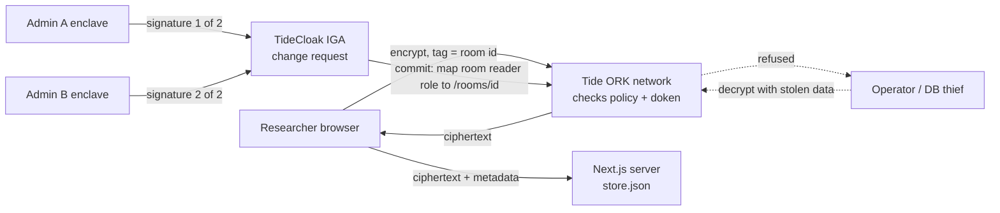

## Project overview

_**Treaty Room** is a sealed research room no one owns: rival universities, drug companies and hospitals deposit unpublished and failed results, and it opens to all of them at once only when their admins co-sign the treaty._

Built with [TideCloak](https://tide.org/tidecloak?utm_source=github&utm_medium=readme&utm_campaign=unlocked).

### 1. Vision & originality

<!-- What new product, service, experience or way of working are you proposing? What makes your idea distinctive? -->

A neutral data room with no neutral host. Deposits are encrypted in the researcher's browser and stay sealed, even to depositors, until 2 of 3 institutions sign; then every member gets access at once. Nobody reads first, so nobody has to trust first.

### 2. Trust constraint insight

<!-- What is difficult, risky or impossible today because trust, privacy or security gets in the way? Explain what becomes possible when that constraint is removed. -->

Failed and unpublished results stay in drawers: pooling them means trusting a host that could read or leak them, or a partner who could read first and publish first. Data trusts only move that trust. Remove it and competitors can pool evidence before publication.

### 3. Value & impact

<!-- Who would benefit, and how would their lives or work improve? Give a concrete example of why this matters. -->

Northbridge University, Helix Therapeutics and St Aurelia Hospital pool Alzheimer's p-tau217 blood-test results, dead ends included, so nobody funds a cohort another lab saw fail. In Malaysia, Sunway Institute, Helix and KL General Hospital pool dengue vaccine safety signals; spotting one early protects trial volunteers.

### 4. Why TideCloak matters

<!-- How does your application use TideCloak, and how does that integration help enable your idea? Connect the technology to the possibility you are demonstrating. -->

- Tide's ORK network threshold-signs logins; we hold no passwords and can't mint tokens.
- Each room has two `RelationshipAttestation:1` policies: members (the room's group) may encrypt; only holders of the room's own reader role may decrypt. Tide's nodes check this on every operation. Plaintext never reaches us.
- The seal: the reader role (with `_tide_decryptor`) reaches the room only through a quorum change request, signed in each admin's own Tide enclave. We can't grant it. Joining is governed likewise.

### 5. Prototype & storytelling

<!-- What does your prototype demonstrate today? Describe the key interaction judges should look for. -->

Three institutions deposit; decryption is refused. A rogue steward grants himself early access and stalls at 1 of 2 approvals. A second admin co-signs and the room opens for all. The Operator view shows what a database thief gets, and Tide refusing to decrypt it.

## Demo video

[demo/video.mp4](demo/video.mp4) (2 minutes). Team **Sunway PowerRanger**, judged in Malaysia.

## How it works

- **Identity.** Users sign in with Tide. Tokens (and the doken that carries realm roles and groups) are threshold-signed by Tide's ORK network, so the app server can verify them but cannot forge them.
- **Rooms.** Each room is a TideCloak group, `/rooms/<id>` (`alz-biomarkers`, `dengue-vax`). The group carries `_tide_encryptor`, so members can deposit.
- **Room policies.** A realm admin signs two policies per room in their Tide enclave (**1. Sign deposit policy**, **2. Sign reading policy**), both under Tide's built-in `RelationshipAttestation:1` contract with the room id as the only tag. Deposit: subject = the room group, role `_tide_encryptor`. Reading: subject = the realm role `room-<id>-reader`, role `_tide_decryptor`. Tide's decentralised nodes check the user's doken against the policy on every `doEncrypt`/`doDecrypt`.
- **The seal.** No one holds `room-<id>-reader` at first, so deposits can be written but not read. The unseal maps it (with `_tide_decryptor`) onto the room group, and only through an IGA change request; because the reader role is per room, opening one room opens no other under Quorum-Enforced Governance (Tide mode). Approvals are enclave signatures from each admin's own browser, and the threshold is `max(1, floor(0.7 × admins))`, which is 2 of 3. The server-side `authorize` call is refused in multi-admin Tide mode; the Governance page's **Force as operator** button shows TideCloak's answer.
- **Joining.** Adding someone to a room group is also a change request that the quorum must sign.
- **Host view.** The database is one JSON file (`app/data/store.json`): ciphertext, signed policies and metadata. The **Operator view** page shows exactly that, and **Try to decrypt with the stolen data** shows the Tide network's refusal.

Key files: `app/src/lib/tide/relationship.ts` (policy, encrypt, decrypt), `app/src/lib/kcAdmin.ts` (server-side change-request reads and the operator red-team call), `app/src/lib/store.ts` (the ciphertext store), `app/scripts/realm.json.template` (room groups and roles), `app/scripts/init-tidecloak.sh` (realm bootstrap).

## Setup

<!-- How to install and run the prototype. -->

Full copy-paste steps and troubleshooting: [RUN_INSTRUCTIONS.md](RUN_INSTRUCTIONS.md).

TideCloak must run on **Linux with Docker**: Tide's native library for Windows is a stub. We ran the official `tideorg/tidecloak-dev` image in a GitHub Codespace and forwarded its ports to `localhost`.

1. Copy `app/.env.example` to `app/.env` and set `KC_BOOTSTRAP_ADMIN_PASSWORD`, `TIDE_LICENSE_EMAIL` (an address you control) and `TIDE_TERMS_ACCEPTED=yes`. Set the last one only after reading [tide.org/legal](https://tide.org/legal).
2. On the Docker host, run `bash scripts/codespace-tidecloak.sh`. It starts `tideorg/tidecloak-dev` on port 8080 and runs `app/scripts/init-tidecloak.sh`, which creates realm `consortium` with the room groups, licenses it, enables IGA and prints an invite link. Open the link to enrol the first admin in the Tide enclave.
3. If TideCloak runs in a Codespace, forward the ports before opening that invite link: `gh codespace ports forward 8080:8080 3000:3000`.
4. `cd app && npm install && npm run dev`, then open <http://localhost:3000>.
5. Enrol three admins (one per institution) for a real 2-of-3 quorum. The first admin signs each room's policies (**1. Sign deposit policy**, **2. Sign reading policy**).

If `registry.npmjs.org` fails TLS on your network: `npm install --registry=https://registry.yarnpkg.com`.

## Limitations

- **Metadata is visible to the host.** Who deposited, when, and how big; never the content.
- **Whoever serves the JavaScript is trusted.** A malicious host could ship code that exfiltrates plaintext after it is decrypted in the browser.
- **Revocation is forward-only.** Removing a member stops future decryptions; anything they already read stays read.
- **Admitted members can copy.** Once the room unseals, a member can export what they see.
- **The host can delete or withhold ciphertext.** It cannot read or forge it, but it can deny service.
- **Two institutions can unseal over the third.** That is the agreed treaty rule (2 of 3), not a bypass.
- **Demo only.** All data is synthetic, and TideCloak runs from the `tideorg/tidecloak-dev` development image.

## Credits

Team **Sunway PowerRanger** for the RMIT x Tide UNLOCKED Challenge 2. Built on Tide's `nextjs-e2ee-vault` template, with TideCloak and Tide's `RelationshipAttestation:1` contract. Institutions, researchers and results are fictional; no real patient or trial data is used.
