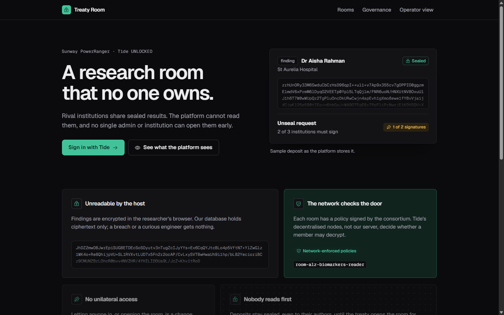
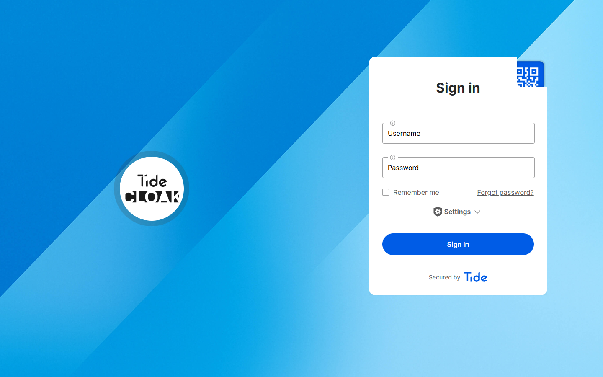

# Live TideCloak evidence

The app on `main` signs in with Tide only (section 8). The demo video was recorded from branch `walkthrough-demo`, which simulates the Tide calls, because no Tide account could be created on 22 Oct 2026 (see "Outage" below).
This page records what **did** run against real TideCloak and the real Tide network, so the integration can be checked.
Every value below is copied from real output on the day. Tokens, keys, passwords, invite links and the licence email are redacted.

## 1. Environment

| Item | Value |
|---|---|
| Server | Official `tideorg/tidecloak-dev:latest` (TideCloak 0.14.41, Keycloak 26.7.5) |
| Host | GitHub Codespace (Linux + Docker), started 2026-10-22 05:59 UTC (13:59 MYT) |
| Why not the laptop | Tide's Windows native library in the image (`MidgardCore.dll`) exports only 5 functions and lacks `initialize_wallet`, so licensing fails on Windows |
| Bootstrap | `app/scripts/init-tidecloak.sh` (Tide's template script) via `scripts/codespace-tidecloak.sh` |

## 2. Realm bootstrap (log excerpt)

```text
==> Licence email: <redacted>
==> Terms & Conditions (https://tide.org/legal): accepted by the operator
==> Using already-running TideCloak at http://localhost:8080
  TideCloak is ready.
==> Creating realm 'consortium' with E2EE roles...
==> Disabling the first-broker-login profile page...
==> Initializing Tide realm (license + VRK)...
==> Stamping iga.attestor=tide...
==> Enabling IGA...
==> Approving client change requests...
==> Creating admin user...
==> Generating invite link...
Waiting for admin to link Tide account (polling every 5s)...
```

The script exits on any licensing failure (`setUpTideRealm` non-2xx or `NEED_PAYMENT`), so reaching the IGA and admin steps means the realm was licensed and its vendor key (VRK) created on the Tide network.

## 3. Realm state, read back from the TideCloak admin API

```json
{
  "realm": "consortium",
  "enabled": true,
  "attributes": { "isIGAEnabled": "true", "iga.attestor": "tide" }
}
```

- Identity provider: `{"alias": "tide", "providerId": "tide", "enabled": true}`
- Realm roles: `_tide_enabled`, `_tide_encryptor`, `_tide_decryptor`, `_tide_vault.selfencrypt`, `_tide_vault.selfdecrypt`, `room-alz-biomarkers-reader`, `room-dengue-vax-reader`
- Room groups (the seal): `/rooms/alz-biomarkers` and `/rooms/dengue-vax` each carry only `_tide_encryptor`. Neither carries `_tide_decryptor` or its reader role, so members can deposit but nobody can read until a quorum change request maps them.

## 4. Quorum-enforced governance (IGA, Tide mode)

A governed admin write is not applied; TideCloak answers **HTTP 202** with a change request. Real response when we added the per-room reader role:

```json
{"status":"PENDING","changeRequestId":"458adb5f-1817-4fa0-952c-f586f7d9bdda","entityType":"ROLE","actionType":"CREATE_ROLE","message":"Change request created — awaiting approval"}
```

Change requests on the realm (read back via `GET /admin/realms/consortium/iga/change-requests?status=...`):

| Status | Count | By action |
|---|---|---|
| APPROVED | 266 | ADOPT_* x263 (baseline adoption when IGA was switched on), CREATE_ROLE x2 (the two `room-*-reader` roles), CREATE_USER x1 (the first admin) |
| PENDING | 0 | |

These were approved in first-admin mode (before any `tide-realm-admin` exists, threshold 1, as Tide's bootstrap does). After the first admin enrols, approvals switch to enclave signatures with a threshold of `max(1, floor(0.7 x admins))`, which is 2 of 3 for three institution admins.

## 5. Adapter config exported for the app

`app/data/tidecloak.json` (gitignored) contains Tide's extensions, which only exist on a licensed realm with IGA on:

`auth-server-url, backgroundUrl, client-origin-auth-http://localhost:3000, client-origin-auth-http://localhost:8080, confidential-port, gVRKCertificate, gVVK, homeOrkUrl, jwk, logoUrl, obfGVVK, orkUrl, payerPublic, public-client, realm, resource, ssl-required, thresholdN, thresholdT, vendorId, vvkId`

with `thresholdT=14`, `thresholdN=20`, `homeOrkUrl=https://ork1.tideprotocol.com`. The live app loads this file: `withAuth` verifies tokens against its `jwk`, and room policies are signed for its `vendorId`.

## 6. Outage: why no Tide account could be created

| Time (MYT) | What happened |
|---|---|
| ~14:35 | In the Tide enclave, "Create an account" failed: `Error creating user account`. Browser console: request to `https://ork2.tideprotocol.com/Authentication/Create/SetCMK` failed (CORS / `net::ERR_FAILED`). |
| 14:38 to 14:45 | Probing `https://ork2.tideprotocol.com/` from the Codespace: HTTP 000 after 40 s, 200 after 28 s, then `503 upstream connect error or disconnect/reset before headers ... delayed connect error: Connection refused`. ork3 and ork7 also flapped. Creating a new account needs every selected ORK to answer. |
| ~16:05 | After ork2 recovered, the enclave refused new accounts with "max user created, contact admin" (`TIDE-ORK-VOUCHER-SUBSCRIPTION_EXCEEDED_CONCURRENT`), probably because earlier half-completed attempts used up the free-tier allowance. |
| 16:14 and 16:18 | A fresh realm (`treatyroom`) could not be licensed: `setUpTideRealm` returned `TIDE-IDPEXT-VENDOR-KEYGEN_FAILED`. Server log: `Initialized subscription for realm treatyroom on tier free, awaiting vendor payment` then `[Midgard] FinalizeWallet failed: HttpRequestException: Response status code does not indicate success: 500 (Internal Server Error).` |
| ~16:50 to 17:00 | On a third realm (`consortium2`, licensed on a second email the user chose), new Tide accounts could be created, but every sign-in failed inside the Tide enclave with a signature check error (`BLIND_VERIFY`), a Tide-side fault. No admin could link, so a live recording was impossible before the deadline. |

Separately, the venue network intercepted TLS for `*.tideprotocol.com` (`SEC_E_UNTRUSTED_ROOT` from the laptop), so the browser reached Tide through an SSH SOCKS proxy via the Codespace.

## 7. What this does and does not prove

- **Proven live:** TideCloak running the official image; realm licensed with a Tide vendor key; IGA in Tide mode; governed writes become change requests (HTTP 202); the room seal model (groups with `_tide_encryptor` only, per-room reader roles) exists in the real realm; Tide adapter config exported.
- **Not proven live:** Tide login, enclave signing of the room policies, and `RelationshipAttestation:1` encrypt/decrypt on the Tide network. All three need an enrolled Tide account, which the outage prevented. Also not observed live: TideCloak refusing the master-admin `authorize` call in multi-admin mode (documented by Tide; no second admin could enrol). The code paths are in `app/src/lib/tide/relationship.ts` (Tide's helper, unchanged) and `app/src/app/room/page.tsx`; the demo recording on branch `walkthrough-demo` replays the same checks with a simulation.

## 8. Tide-only login (main)

Walkthrough mode (simulated persona sign-in, simulated enclave, the `/walkthrough` page and the `/api/wt/*` routes) has been removed from `main`. On `main` the only way to sign in is Tide. The build the demo video was recorded from is kept on the branch `walkthrough-demo`.

### Sign-in hands off to Tide

Checked on 22 Oct 2026 against the running stack (app on `http://localhost:3000`, TideCloak realm `consortium` on `http://localhost:8080`). Clicking **Sign in with Tide** went through TideCloak and its `tide` identity-provider broker and landed on the real Tide sign-in page on `https://ork1.tideprotocol.com` (page title "Tide", Username and Password fields, "Secured by Tide"). No credentials were typed, because Tide account creation is still blocked (section 6).





URL chain (top-level documents and the iframes they load; query values removed, parameter names kept):

| Step | Request | Status |
|---|---|---|
| 1 | `GET http://localhost:3000/` | 200 |
| 2 | keycloak-js background iframes: `GET http://localhost:8080/realms/consortium/protocol/openid-connect/3p-cookies/step1.html`, then `.../3p-cookies/step2.html`, then `.../login-status-iframe.html` | 200 each |
| 3 | Click **Sign in with Tide**: `GET http://localhost:8080/realms/consortium/protocol/openid-connect/auth?client_id&redirect_uri&state&response_mode&response_type&scope&nonce&code_challenge&code_challenge_method&dpop_jkt` | 303 |
| 4 | `GET http://localhost:8080/realms/consortium/broker/tide/login?session_code&client_id&tab_id&client_data` | 303 |
| 5 | `GET https://ork1.tideprotocol.com/?sid&gVVK&authorizerPack&gVRKSignature&vRedirectUri&rURISignature&signedSettings&settingsSignature&voucherURL&type&state&iframePath&dpop_jkt&clientOrigin&clientOriginAuth` (the Tide sign-in page, where the browser ended) | 200 |
| 6 | Loaded by the Tide page, matching its `iframePath`: `GET http://localhost:3000/tide_dpop/iss/<hex of http://localhost:8080/realms/consortium>/aud/<hex of consortium-client>/tide_dpop_auth.html?version&openerOrigin` | 200 |

The auth request comes from the public client `consortium-client` and carries PKCE (`code_challenge`) and a DPoP key thumbprint (`dpop_jkt`). Step 6 shows the app's DPoP helper page is served and reached by the Tide page.

### APIs return 401 without a Tide token

Every route under `app/src/app/api` was called on the live server (GET, plus POST where the route exports it), each four ways: no `Authorization` header, `Bearer wt.lee` (the old walkthrough token form), an unsigned `alg: none` JWT as `Bearer`, and the same JWT as `DPoP`.

| Method and route | No auth | `Bearer wt.lee` | alg-none `Bearer` | alg-none `DPoP` |
|---|---|---|---|---|
| GET `/api/governance` | 401 | 401 | 401 | 401 |
| POST `/api/join` | 401 | 401 | 401 | 401 |
| GET, POST `/api/me` | 401 | 401 | 401 | 401 |
| GET, POST `/api/operator` | 401 | 401 | 401 | 401 |
| GET, POST `/api/policy` | 401 | 401 | 401 | 401 |
| GET, POST `/api/posts` | 401 | 401 | 401 | 401 |
| GET `/api/rooms` | 401 | 401 | 401 | 401 |
| GET, POST `/api/wt/approve` (removed) | 404 | 404 | 404 | 404 |
| GET, POST `/api/wt/kc/realms/consortium` (removed) | 404 | 404 | 404 | 404 |
| GET `/api/join` | 405 | 405 | 405 | 405 |

- Every protected route and method returns 401 in all four cases. The 401 bodies on `/api/me` show which check rejected each token: `Missing Authorization header` (no auth), `Invalid Compact JWS` (`wt.lee`), and `Unsupported "alg" value for a JSON Web Key Set` (alg-none, both schemes), so tokens are verified against the realm JWKS.
- The removed walkthrough routes return 404, so the simulated sign-in path is gone from the live server.
- `GET /api/join` returns 405 because that route only exports POST. (`/api/config`, the template's unauthenticated adapter-config route, was deleted after this test; nothing used it.)

## Reproduce

With TideCloak running (the live-mode steps in `RUN_INSTRUCTIONS.md`) and a master-admin token in `$T`:

```bash
R=http://localhost:8080/admin/realms/consortium
curl -s $R -H "Authorization: Bearer $T" | jq '{realm, attributes: (.attributes | {isIGAEnabled, "iga.attestor": .["iga.attestor"]})}'
curl -s "$R/iga/change-requests?status=APPROVED" -H "Authorization: Bearer $T" | jq 'group_by(.actionType) | map({(.[0].actionType): length}) | add'
```
